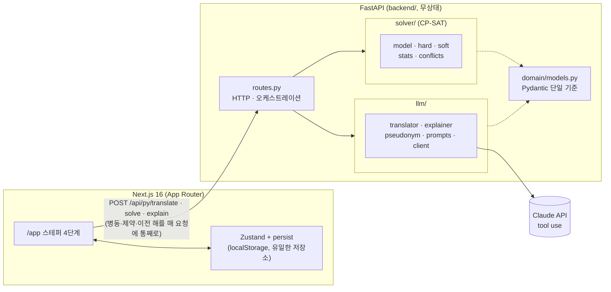

# 간호사 근무표 (LLM + CP-SAT)

수간호사가 말로 설명한 규칙과 요청으로 한 달 3교대 근무표를 만들고, 막히는 이유와 해결책을 설명받는 포트폴리오 프로토타입입니다. 계산은 OR-Tools CP-SAT 솔버가 하고, Claude는 자연어 번역과 충돌 설명만 맡습니다.

데모: <!-- DEMO_URL -->

## 문제와 사용자

**사용자**: 병동 1개를 맡은 수간호사. 예를 들어 로테이션 인원 15명, 3교대(D/E/N)입니다. 병동에 따라 매주(1·2·4주 단위) 또는 매달 근무표를 새로 짜고, 엑셀과 머릿속 규칙으로 매번 며칠씩 걸립니다. 엑셀은 능숙하지만 설정 화면은 싫어하고, 말로 설명하는 편이 편합니다. 포트폴리오 방문자는 로그인 없이 샘플 데모(보기 전용)를 둘러봅니다.

| 페인 포인트 | 해결 기능 |
|---|---|
| 규칙이 머릿속에만 있다 | 자연어 → 규칙 카드 |
| 요청이 다 안 들어가는데 어디서 막히는지 모른다 | 충돌 설명과, 재풀이로 검증된 완화 제안 |
| 확정 후 병가가 생기면 전체를 다시 짠다 | 최소 변경 재스케줄 |
| "왜 나만 주말이 많아요?"에 근거를 대기 어렵다 | 개인별 통계와 누적 부담 |
| 매번 명단, 규칙, 지난 기간 마지막 근무를 다시 옮겨 적는다 | 저장된 병동과 자동 이월 |
| 지난번에 나이트를 많이 한 사람을 이번에 배려하기 어렵다 | 최근 4주 누적 부담을 공정성에 반영 |

## 데모

<!-- 데모 GIF: docs/demo.gif 또는 public/demo.gif 에 녹화본을 넣고 아래 줄의 주석을 푼다.
     public/demo.gif 가 있으면 랜딩 페이지(/)의 데모 섹션에도 자동으로 표시된다. -->
<!--  -->

화면은 랜딩(`/`)과 앱(`/app`, 스테퍼 ① 병동 → ② 규칙 → ③ 이달 요청 → ④ 근무표) 두 개입니다. 데모 저니:

1. 랜딩에서 [근무표 만들기] → 15명 명단을 붙여넣고 공휴일 1일을 체크한다.
2. 규칙 3개를 말로 입력한다: 나이트 다음 날 휴무, 나이트 3연속 상한, 조마다 3년차 이상 1명.
3. 요청 2개를 입력한다: 휴가(hard), 주말 오프 희망(soft).
4. 생성 → 근무표, 요약(희망 반영 수, soft 위반), 개인별 통계.
5. 휴가 2건을 추가하면 해가 없다고 나오고, 충돌 설명과 재풀이로 검증된 제안이 뜬다. 수락하면 해결된다.
6. 칸을 자물쇠로 고정한 뒤 재풀이한다.
7. 확정하고 CSV(UTF-8 BOM)를 받는다.
8. "최지훈 이번 주 병가"를 입력하면 최소 변경으로 재스케줄하고 변경된 칸을 하이라이트한다.

## 아키텍처



`solver/`와 `llm/`은 서로 import하지 않고, 둘의 조합은 `routes.py`에서만 합니다. `api/index.py`는 Vercel 진입점만 두고, `/api/py/*`는 이 함수로 리라이트됩니다(로컬은 uvicorn :8000).

**역할 분리: LLM은 번역과 설명, 솔버는 계산.**

- **번역**(`/translate`): "나이트 다음 날은 무조건 쉬게" → Claude가 제약 템플릿 12개 중 하나를 고르고 파라미터를 채운 제약 스펙. 코드는 만들지 않습니다.
- **계산**(`/solve`): CP-SAT가 인원, 금지 순서, 연속 근무, 휴가 등 hard 제약을 지키면서 희망과 공정성 같은 soft 페널티를 최소화합니다. 이 경로는 LLM을 쓰지 않습니다.
- **설명**(`/explain`): 해가 없으면 솔버가 충돌하는 제약 집합을 찾고, Claude가 그 원문을 바탕으로 이유를 설명하고 완화 제안을 냅니다. 제안마다 서버가 다시 풀어 해가 나오는 것만 돌려줍니다.

```
규칙 입력:  UI → /translate → 가명 치환 → Claude(tool use) → Pydantic 검증(재시도 ≤2) → 제안 카드 → [적용] → store
생성:      store 전체 → /solve → CP-SAT → ok | infeasible | timeout
해 없음:   infeasible + conflicts → /explain → 설명 + 제안 ≤3 → 제안마다 재풀이 → 해가 나오는 것만 → [수락] → /solve
```

## 설계 결정

전체 내용은 [docs/ADR.md](docs/ADR.md)에 있습니다.

- [ADR-001](docs/ADR.md): **계산은 CP-SAT, LLM은 번역과 설명만.** LLM은 조합 최적화에서 제약을 자주 어기지만, 솔버는 해가 없음을 증명하고 충돌 원인을 찾을 수 있습니다.
- [ADR-002](docs/ADR.md): **LLM은 템플릿 12개 중에서 고르고 파라미터만 채운다.** 출력을 검증할 수 있고 eval로 정확도를 잴 수 있습니다. 템플릿에 없는 규칙은 `unsupported`로 거절합니다.
- [ADR-003](docs/ADR.md): **Pydantic을 단일 기준으로.** `backend/domain/models.py` 하나에서 tool `input_schema`, 입력 검증, 솔버 입력, `lib/types.gen.ts`를 모두 만들어 계층 간 스키마 불일치를 없앱니다.
- [ADR-004](docs/ADR.md): **LLM 출력은 검증을 통과한 "제안"으로만 쓴다.** 환각이 근무표에 직접 들어가지 않고, 프롬프트 인젝션의 영향도 잘못된 제안 카드 하나에 그칩니다.
- [ADR-005](docs/ADR.md): **백엔드는 무상태, 저장은 클라이언트 localStorage.** DB 없이 매 요청에 상태를 통째로 보내므로 서버리스와 잘 맞고 재현이 단순합니다.
- [ADR-009](docs/ADR.md): **LLM 호출 전 이름 가명화.** 명단의 이름을 `N01` 같은 가명으로 바꿔 보내 개인정보를 최소한으로 내보냅니다.

## LLM 출력을 믿지 않는 방법

- **스키마 검증과 재시도**: tool use로 받은 출력을 Pydantic으로 검증하고, 실패하면 오류 내용을 대화에 넣어 최대 2회 재시도합니다. 그래도 안 되면 `502 LLM_INVALID_OUTPUT`.
- **참조 무결성**: 명단에 없는 간호사, 대상 월 밖의 날짜 같은 참조 오류는 되묻기(`clarify`)로 돌립니다. explain 제안이 충돌 목록 밖의 제약을 건드리면 버립니다.
- **사람의 적용**: 번역 결과는 항상 "적용 대기" 카드로 보여주고, [적용]을 눌러야 store에 들어갑니다. hard/soft 토글과 수정도 카드에서 합니다.
- **재풀이 검증**: 충돌 완화 제안은 서버가 제안대로 제약을 바꿔 다시 풀어 보고(제안당 3초), 해가 나온 것만 "검증됨" 배지와 함께 보여줍니다.
- **결정적 대체 경로**: explain이 실패해도 충돌 제약의 원문 목록과 [이번 달만 끄기]로 진행할 수 있습니다.
- **가명 처리**: LLM 호출 전 성명과 유일한 이름을 가명으로 바꾸고 응답에서 되돌립니다. 로그에도 이름 원문과 키를 남기지 않습니다.

## Eval

자연어 → 제약 번역 정확도를 수간호사 말투 데이터셋으로 측정했습니다. 데이터셋은 44개(병동 규칙 16, hard/soft 판정 4, 이달 요청 17, 되묻기 4, 미지원 3)이고, type·hardness·params를 다중집합으로 매칭해 채점합니다. 실행 이력과 실패 케이스는 [eval/results.md](eval/results.md)에 있습니다.

모델 `claude-sonnet-5-5`, 3회차 실행 결과:

| 지표 | 값 |
|---|---|
| 케이스 수 | 44 |
| 스키마 유효율 | 100.0% |
| status 정확도 | 100.0% |
| 제약 precision | 100.0% |
| 제약 recall | 100.0% |
| 제약 F1 | 100.0% |
| 케이스 완전 일치율 | 100.0% |
| clarify 정확도 | 100.0% |
| unsupported 정확도 | 100.0% |
| 평균 재시도 횟수 | 0.00 |
| 평균 지연(초) | 1.95 |
| p95 지연(초) | 2.76 |
| 입력 토큰 합계 | 255,716 |
| 출력 토큰 합계 | 7,351 |

1회차는 모델이 강제 `tool_choice`를 거절해 0%였고, 2회차(F1 97.9%)에서 실패한 1건을 보고 프롬프트를 고친 결과가 3회차입니다. 데이터셋의 기대값은 고치지 않았습니다.

## AI로 만든 방법

이 저장소는 Claude Code와 자체 harness로 만들었습니다. 사람은 문서(`docs/`의 PRD, ARCHITECTURE, ADR, UI_GUIDE)와 step 설계를 맡고, 구현은 harness가 step 단위로 자동 실행했습니다.

- **phase/step 구조**: `phases/1-mvp/`에 `step0.md`~`step15.md` 16개 step 파일과 `index.json`(상태와 summary)이 있습니다. step마다 한 레이어만 다루고(도메인 스키마 → 솔버 hard/soft/충돌/재스케줄 → LLM translator/explainer → API → eval → UI → 랜딩 → README), 읽을 파일, 작업, 실행 가능한 Acceptance Criteria, 금지사항을 적어 독립된 세션에서 실행되게 했습니다.
- **실행기**: `python3 scripts/execute.py 1-mvp`가 pending step을 순서대로 Claude 세션에 넘깁니다. 프롬프트에는 `CLAUDE.md`, `docs/*.md`, 완료된 step의 summary가 들어갑니다. 세션이 끝나면 AC 명령을 직접 다시 돌려 확인하고, 실패하면 오류를 넣어 최대 3회 재시도합니다. 통과하면 코드(`feat`)와 메타데이터(`chore`)를 나눠 커밋합니다.
- **가드 훅** (`.claude/settings.json`)
  - TDD 가드(`scripts/hooks/tdd-guard.sh`): `backend/`와 `lib/` 순수 함수는 테스트 파일이 먼저 없으면 구현 파일 작성을 막습니다. UI 컴포넌트와 `lib/api.ts`는 예외입니다(ADR-012).
  - 위험 명령 차단: `rm -rf`, `git push --force`, `git reset --hard` 등.
  - 종료 시 검증: 세션이 끝날 때 lint, build, test를 돌리고 실패하면 고치도록 되돌립니다.
- **step별 summary**: 각 step은 끝나면 산출물을 한 줄로 `index.json`에 남기고, 다음 step이 이를 맥락으로 받습니다. 예:
  - Step 3 (solver-conflicts): hard 제약 리터럴을 assumptions로 걸어 충돌 core를 구하고 시간 예산 안에서 축소
  - Step 9 (eval-run): 실제 API로 eval 3회 실행, `tool_choice` 수정과 프롬프트 지시 추가로 F1 100%
  - Step 13 (ui-conflicts-changes): 해 없음 패널, 검증된 제안 카드, 월중 변경과 diff 하이라이트

## 로컬 실행

필요한 것: [uv](https://docs.astral.sh/uv/)(Python 3.12, `.python-version`), Node.js와 npm.

```bash
# Python 의존성 (.venv)
uv venv --python 3.12
uv pip install -r requirements-dev.txt

# JS 의존성
npm install

# .env.local (저장소에 커밋하지 않음)
#   ANTHROPIC_API_KEY=...
#   ANTHROPIC_MODEL=claude-sonnet-5-5   # 선택, 기본값
#   NEXT_PUBLIC_SUPABASE_URL=...        # 없으면 앱은 로그인 설정 안내만 보인다
#   NEXT_PUBLIC_SUPABASE_ANON_KEY=...
#   E2E_TEST_EMAIL, E2E_TEST_PASSWORD   # e2e 전용, docs/BROWSER_TEST_SCENARIOS.md 참고

npm run dev                 # Next :3000 + FastAPI :8000 (/api/py/* 리라이트)
npm run test                # pytest (backend/tests, scripts/test_hooks.py) + vitest
npm run build && npm run lint
uv run python eval/run.py   # 번역 eval (API 키 필요, 결과는 eval/results.md)
```

`uv run python eval/run.py --dry-run`은 API를 호출하지 않고 데이터셋만 검증합니다. Pydantic 모델을 바꾼 뒤에는 `npm run gen:types`로 `lib/types.gen.ts`를 다시 만듭니다.

## 범위 밖

MVP에서 의도적으로 뺀 것들입니다([docs/PRD.md](docs/PRD.md)).

- 결제, 공유 링크, 다중 기기 실시간 동기화
- 다중 병동, 병동 공유와 다중 사용자, 간호사 본인용 화면, 수간호사 본인 근무
- 근무 교환, Google 외 로그인, 인증 계정 자체 삭제, 확정본 버전 비교·복원 화면, API 사용량 제한
- 인쇄용 뷰, JSON 내보내기/불러오기
- LLM 요약 문장, 공정성 Q&A, 가중치 UI
- 모바일, 다국어, 스트리밍
- 자체 솔버, 모델 비교 eval
