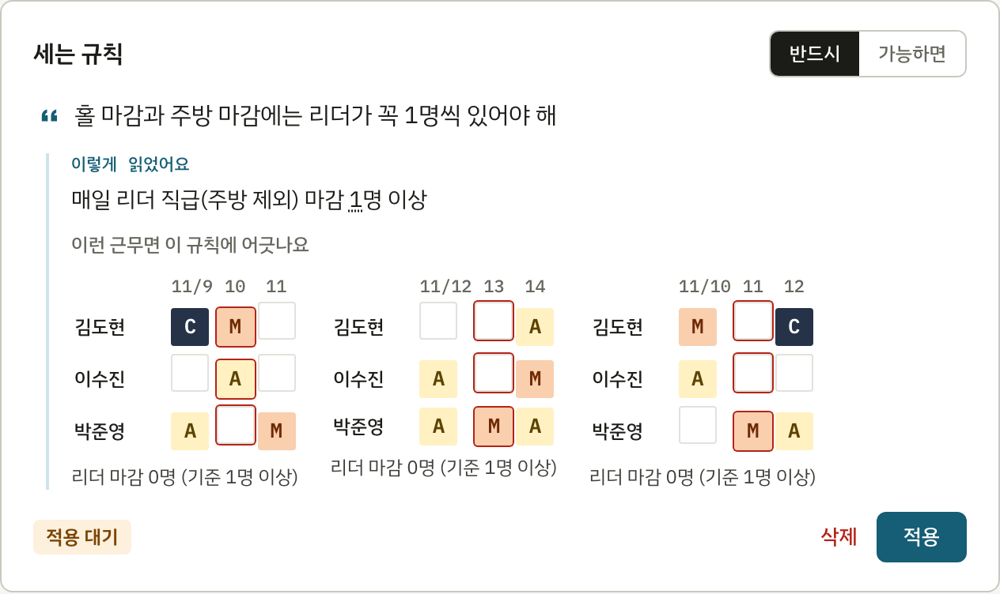
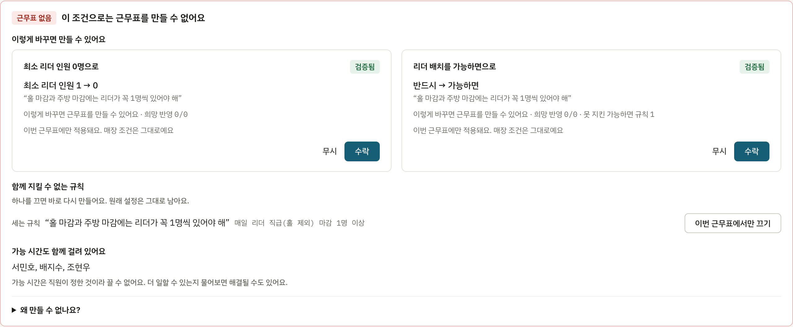
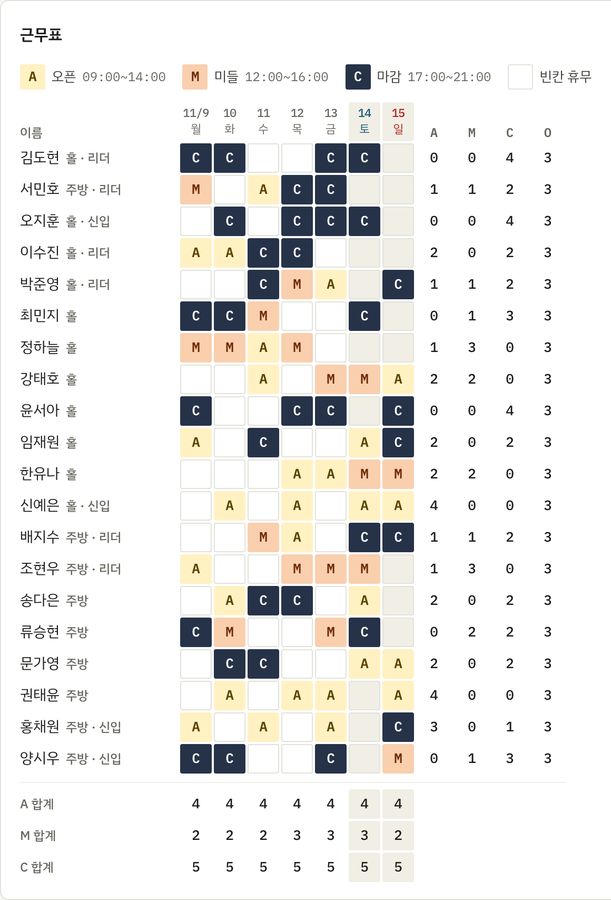

# 스케줄링 AI

**스케줄링 매니저를 위한 근무표 작성 서비스**

직원은 링크로 가능 시간을 칠하고, 매니저는 매장 조건을 말로 적으면 근무표가 만들어집니다. 조건이 서로 부딪혀 막히면 이유와 해결책까지 알려 줍니다.

**[바로 체험하기](https://optimize-schedule-ai.vercel.app/demo)** · [서비스 열기](https://optimize-schedule-ai.vercel.app) · [▶ 데모 영상 (2분)](public/demo.mp4)

체험은 로그인 없이 샘플 매장(한강 다이닝, 직원 20명)에서 시작합니다. 직원이 가능 시간을 모두 낸 상태에서 매장 조건 카드를 적용하고 근무표를 만들어 보세요. 조건이 부딪혀 근무표가 나오지 않는 상황과, 검증된 해결책을 수락해 근무표가 나오는 과정을 그대로 볼 수 있습니다. 바꾼 내용은 저장되지 않습니다.

## 누구를 위한 서비스인가요

카페나 음식점처럼 파트타임 직원이 많은 매장에서 근무표를 짜는 매니저를 위한 서비스입니다. 메신저로 가능 시간을 모으고, 엑셀과 머릿속 규칙으로 근무표를 짜고 있다면 그 과정을 그대로 덜어 줍니다.

## 이렇게 사용해요

1. **가능 시간 받기** — 단체 대화방에 링크 하나만 올리면, 직원이 로그인 없이 자기 이름을 골라 일할 수 있는 시간을 칠합니다. 여러 날을 가로질러 끌면 한 번에 칠해지고, 하루 칠한 시간을 모든 날에 복사할 수 있습니다. 한국 공휴일은 근무표에 자동으로 들어갑니다.
2. **매장 조건 말하기** — 필요 인원과 규칙을 평소 말투로 적으면 카드로 정리됩니다. 카드는 어떻게 읽었는지와 어긋나는 근무 예시를 보여 주고, 매니저가 [적용]을 눌러야 들어갑니다. 한 번 적용한 조건은 다음 근무표에도 그대로 이어집니다.
3. **근무표 만들기** — 버튼 하나로 근무표가 나옵니다. 막히면 어떤 조건끼리 부딪히는지 설명하고, 실제로 근무표가 나오는 해결책만 보여 줍니다.
4. **확정하고 운영하기** — 확정하면 직원 링크가 잠기고, 직원은 같은 링크로 확정 근무표를 봅니다. CSV로도 받을 수 있습니다. 병가가 생기면 말로 적으세요. 바뀌는 칸을 최소로 줄여 다시 만듭니다.

매장 조건은 이렇게 적으면 됩니다.

> 평일 오픈 2명, 주말은 3명
>
> 12시부터 15시까지는 최소 3명
>
> 마감 다음 날 오픈은 안 되게

### 화면

말로 적은 조건이 카드가 됩니다. 어떻게 읽었는지와 어긋나는 근무 예시를 보고 적용합니다.

조건이 부딪히면 이유를 설명하고, 실제로 다시 풀어 본 해결책만 보여 줍니다.

해결책을 수락하면 근무표가 나옵니다.

## 무엇이 달라지나요

| 지금 | 스케줄링 AI에서는 |
|---|---|
| 직원마다 가능 시간을 메신저로 받아 옮겨 적는다 | 링크 하나로 받고 제출 현황까지 한 화면에서 본다 |
| 규칙이 머릿속에만 있다 | 말로 적은 규칙이 카드로 남아 계속 쓰인다 |
| 어디서 막히는지 모른다 | 막힌 이유와 검증된 해결책을 알려 준다 |
| 확정 후 병가가 생기면 전체를 다시 짠다 | 필요한 칸만 바꾸고 바뀐 칸을 표시한다 |
| "왜 나만 주말이 많아요?"에 답하기 어렵다 | 직원별 근무 수, 주말·공휴일 근무, 최근 4주 부담을 보여 준다 |
| 매번 명단과 규칙을 다시 입력한다 | 명단과 조건이 남고 지난 근무도 자동으로 이어진다 |

## 믿고 맡길 수 있도록

- **AI가 근무를 직접 배정하지 않습니다.** AI는 매니저의 말을 규칙으로 옮기고 막힌 이유를 설명합니다. 근무표 계산은 최적화 솔버가 맡습니다.
- **확인한 규칙만 반영합니다.** AI가 정리한 규칙은 매니저가 카드에서 [적용]을 눌러야 들어갑니다.
- **해결책은 미리 검증합니다.** 제안대로 실제로 다시 풀어 보고 근무표가 나오는 것만 보여 줍니다.
- **말을 규칙으로 옮기는 정확도를 측정합니다.** 매니저 말투 102문장 평가에서 99%를 기록했습니다(Claude Sonnet 5.5). ([평가 결과](eval/results.md))

## 어떻게 만들었나요

- **화면**: Next.js (TypeScript). 매장 데이터와 Google 로그인은 Supabase에 둡니다.
- **계산**: FastAPI 위의 OR-Tools CP-SAT 솔버. 규칙을 모두 만족하는 근무표를 찾고, 없으면 어떤 규칙이 부딪히는지 짚어 냅니다.
- **AI**: Anthropic Claude. 매니저의 말을 솔버가 읽는 규칙으로 옮기고, 막힌 이유를 설명하고 완화안을 제안합니다. 제안은 솔버로 다시 풀어 검증한 뒤에만 보여 줍니다.
